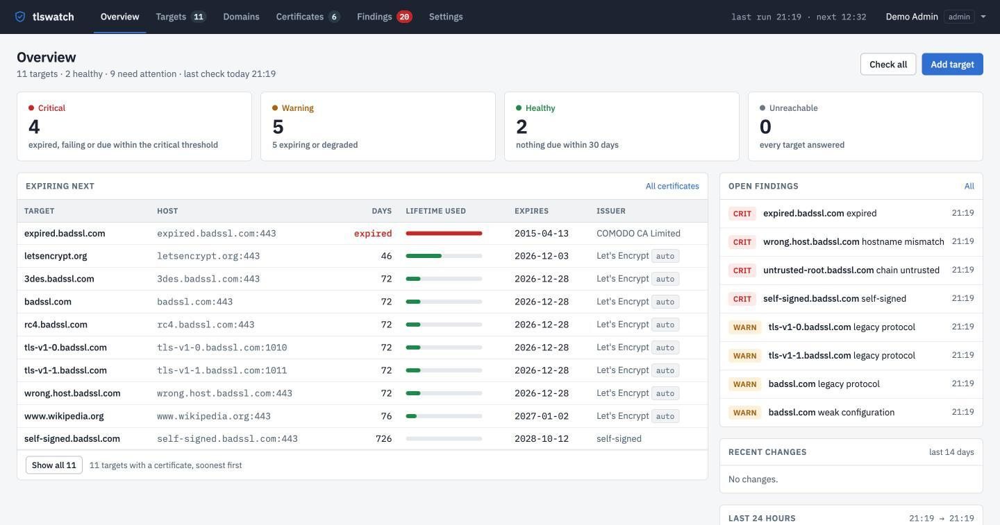
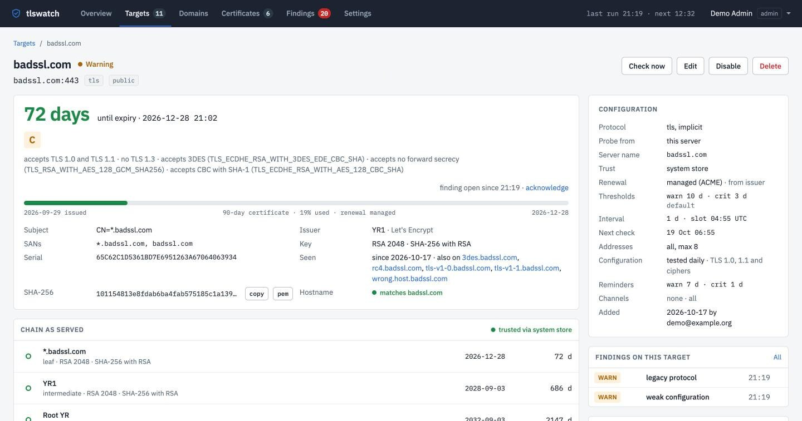

# tlswatch

tlswatch watches the TLS certificates that are actually served on your hostnames and IP addresses. It checks expiry, the chain of trust, the hostname and signature strength, notices when a certificate changes or a server still accepts TLS 1.0, and alerts by e-mail, Telegram, Slack (or Mattermost and Rocket.Chat), Discord, ntfy or a webhook before something expires. It is one self-hosted Go binary with a web UI and a SQLite file; nothing else to run.

**[Try the live demo](https://demo.tlswatch.nl/)**: read-only, no sign-in, watching public endpoints, including the badssl.com hosts that are broken on purpose. Website: [tlswatch.nl](https://tlswatch.nl/).

<picture>
  <source media="(prefers-color-scheme: dark)" srcset="docs/img/overview-dark.jpg">
  
</picture>

- Any port, implicit TLS or STARTTLS (SMTP, IMAP, POP3, FTP, PostgreSQL).
- Every address behind a name is probed, so the one stale node behind a load balancer is caught.
- System store, private CA bundles, or pinned self-signed certificates.
- Let's Encrypt and other ACME renewals are recognised and not alerted.
- A daily test for TLS 1.0 and 1.1, which a server on TLS 1.3 can still accept unnoticed, and for RC4, 3DES, RSA key exchange and CBC suites, summed up in a configuration grade A to F per target with its reasons; switchable per target.
- A certificate inventory: every certificate seen, where it is served, when it expires, exportable as CSV.
- Alerts on transitions, with reminders, recovery notices, acknowledgements (also in bulk) and an optional weekly digest. Mail has a plain-text and an HTML part.
- Live pages that update as checks land.
- **Nodes** probe from inside networks the server cannot reach: one install command, one outbound HTTPS rule, the node updates itself, only to releases signed with the tlswatch release key; the schedule, inventory and alerts stay in one place.
- **Certificate Transparency watching**: every certificate publicly issued for your domains, matched against what the targets serve; one that no target serves is a finding, a renewal on its way is not.
- Roles (viewer, operator, admin), local accounts and Google sign-in, an audit log.
- **Configured in the browser**: SMTP relays, Telegram bots, Slack (Mattermost, Rocket.Chat) and Discord webhooks, ntfy topics, your own webhooks, Google sign-in, thresholds and the public URL all live under Settings.
- Encrypted backup and restore from the UI, also from the setup screen of a new installation.
- Optional Prometheus metrics at `/metrics`, behind a bearer token.

<picture>
  <source media="(prefers-color-scheme: dark)" srcset="docs/img/target-dark.jpg">
  
</picture>

## How it compares

- **Uptime monitors** such as Uptime Kuma check the certificate of an HTTPS monitor as a side effect: one port, one address, expiry only. tlswatch probes every address behind a name on any port, including STARTTLS, and also checks the chain, the hostname and the server's TLS configuration.
- **Certificate Transparency monitors** such as certspotter tell you what was issued for your domains, not what your servers serve. tlswatch does both and matches the two, so a certificate nobody serves stands out and a renewal on its way does not.
- **Hosted certificate monitors** probe from the internet, so internal hosts are out of reach and your inventory lives with them. tlswatch runs on your own machine, and nodes reach the networks it cannot.

## Quick start

With Docker:

```sh
docker run -d --name tlswatch --restart unless-stopped \
  -p 127.0.0.1:8080:8080 -v tlswatch-data:/data \
  ghcr.io/sjoerd305/tlswatch:latest
open http://127.0.0.1:8080/    # create your admin account, then add targets and channels
```

Or with Compose:

```yaml
services:
  tlswatch:
    image: ghcr.io/sjoerd305/tlswatch:latest
    restart: unless-stopped
    ports:
      - "127.0.0.1:8080:8080"
    volumes:
      - tlswatch-data:/data

volumes:
  tlswatch-data:
```

Without Docker, from a release binary or this checkout:

```sh
make build                     # or download a release binary
./tlswatch serve               # creates ./data/ and a secret key on first start
open http://127.0.0.1:8080/
```

The `compose.yaml` in this checkout builds the image from source: `docker compose up --build -d` and open http://127.0.0.1:8081/.

On first start, before any account exists, tlswatch shows a setup screen where you create the first admin with your own e-mail and password, or restore a backup from another installation. Do that right away, before exposing the port beyond localhost.

Try an endpoint from the command line first, no server needed:

```sh
tlswatch check portal.example.nl                 # exit code 0 ok, 1 warning, 2 critical
tlswatch check mail.example.nl:587 -protocol smtp
tlswatch check 10.0.0.5:443 -servername portal.example.nl -ca-file internal-ca.pem
```

`check` prints JSON, including the old TLS versions and weak cipher suites each address still accepts and the grade that follows (`-no-config-test` skips that test).

## Configuration

Everything an operator changes is in the UI. The process itself needs at most these environment variables, all optional:

| Variable | Default |
| --- | --- |
| `TLSWATCH_LISTEN` | `127.0.0.1:8080` |
| `TLSWATCH_DB` | `./data/tlswatch.db` |
| `TLSWATCH_SECRET_KEY_FILE` | `secret.key` next to the database, generated on first start |
| `TLSWATCH_LOG_JSON` | `true` |
| `TLSWATCH_DEBUG` | `false` (debug logging) |
| `TLSWATCH_ACCEPT_NEW_KEY` | unset: a missing key file next to a database with sealed credentials stops the start |
| `TLSWATCH_DEMO` | unset: the path of a demo file runs a public, read-only demo without sign-in (see `demo/`; it runs [demo.tlswatch.nl](https://demo.tlswatch.nl/)) |

Settings that can also be pinned by environment (for containers and GitOps) are shown read-only in the UI; an invalid value stops tlswatch at start with a message naming the variable. See [docs/operations.md](docs/operations.md) and the [specification](docs/specification.md).

Put a reverse proxy with TLS in front before exposing tlswatch, then set the public URL and proxy trust under Settings › General. If you use nodes, give the proxy a read and idle timeout of at least 60 seconds: a node's poll is held for up to 55.

## Backups

- **Settings › Backup** downloads the whole instance as one file encrypted with a passphrase, and restores such a file in place. Stored credentials are re-encrypted for the instance that restores it, so the file moves between hosts without the secret key.
- **`tlswatch backup PATH`** writes a plain database copy, safe while the server runs, for a nightly cron. Keep the secret key with it: stored SMTP passwords, Telegram tokens, webhook URLs and the Google client secret are encrypted with it. `tlswatch rotate-key` replaces the key with the server stopped.

## Commands

```
tlswatch serve                       run the web UI, scheduler and alerting
tlswatch create-admin -email ADDR    create an admin and print a one-time password link
                                     (-out FILE writes the link to a file instead)
tlswatch migrate                     apply database migrations (also done at start)
tlswatch backup PATH                 write a consistent copy of the database
tlswatch healthcheck                 exit 0 when the running server's /healthz is OK
tlswatch rotate-key                  re-encrypt stored credentials under a new secret key
tlswatch check HOST[:PORT] [flags]   probe one endpoint, print JSON, exit 0/1/2 by severity
tlswatch node [flags]                run as a probe node inside another network (enrol, uninstall)
tlswatch version                     print the version
```

## Development

```sh
make test     # the npm dependency check and node --test for the TypeScript helpers, go test -race for the rest
make run      # a throw-away instance on http://127.0.0.1:8080
make lint     # gofmt, go vet, govulncheck, gosec
```

The frontend is server-rendered `html/template` with small dependency-free TypeScript modules compiled by `tsc` (the only npm dependency). The compiled JavaScript in `web/static/js` is committed so `go build` works without Node. See [CONTRIBUTING.md](CONTRIBUTING.md) for the dependency rule and test expectations.

## Licence

MIT. IBM Plex fonts are under the SIL Open Font License, see `web/static/fonts/OFL.txt`.
